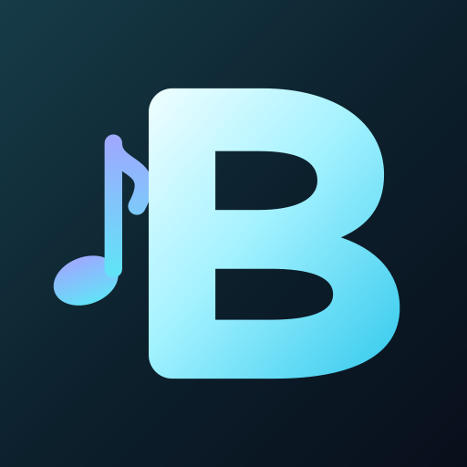
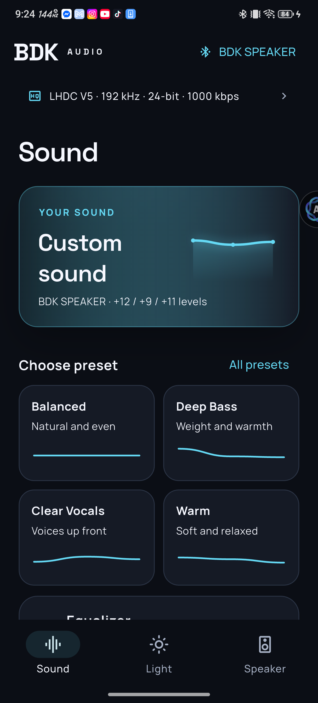
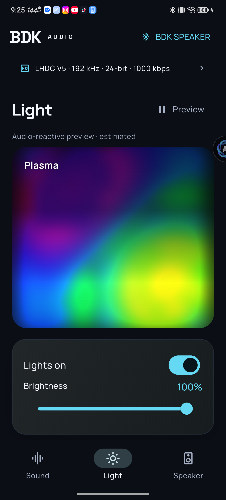
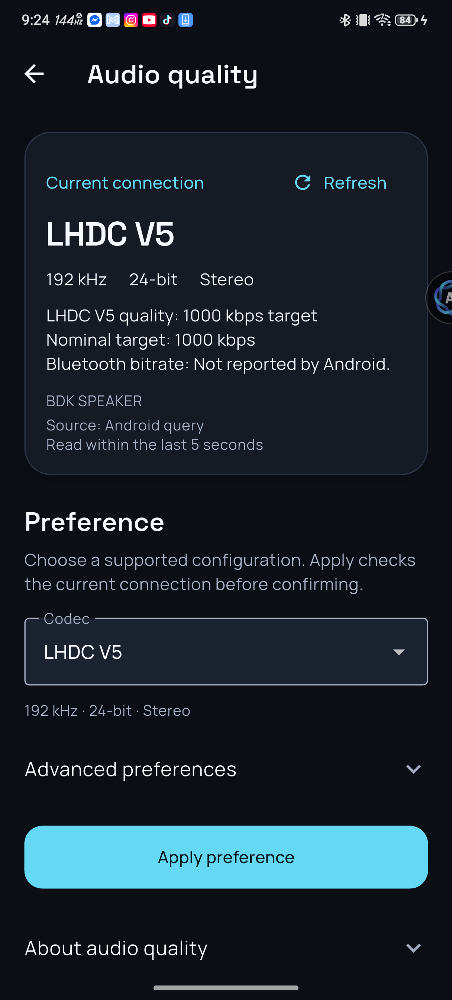

<div align="center">



# BDK Audio

**Your speaker. Your sound. Your light.**

A Flutter companion for BDK ESP32 Bluetooth speakers.


[Screenshots](#screenshots) · [Features](#features) · [Get started](#get-started) · [Platform status](#platform-status) · [Development](#development)

</div>

Shape your sound, personalize the lights and manage your speaker from one focused interface. BDK Audio brings visual presets, three-band equalization, diffused LED previews and detailed Bluetooth audio preferences together in dedicated Sound, Light and Speaker pages.

The Flutter app is the active implementation at the repository root. The original Kotlin app is preserved in [`legacy/kotlin/`](legacy/kotlin/), with the repository's earlier history intact.

## Screenshots

<table>
  <tr>
    <th align="center">Sound</th>
    <th align="center">Light</th>
    <th align="center">Audio quality</th>
  </tr>
  <tr>
    <td></td>
    <td></td>
    <td></td>
  </tr>
</table>

Actual **0.7.2 Android app** captures from a Redmagic NX809J, not HTML mockups. [Screenshot details](docs/images/README.md).

## Features

| | What you can do |
|:--|:--|
| **Sound, shaped visually** | Adjust bass, mid and treble; choose illustrated presets; save, import and export personal profiles. |
| **Lights with depth** | Browse 22 firmware-derived effects with diffused, hardware-rendered previews. Adjust brightness, animation speed, colors and Ambient controls. |
| **Audio configuration at a glance** | See the current codec, sample rate, bit depth and recognized bitrate target in a compact strip across all three main tabs. |
| **Detailed Android codec preferences** | Request supported codecs and formats, with LDAC and recognized LHDC V5 bitrate choices. Apply checks the current device and reads back the resulting configuration. |
| **Guided connection** | Discover compatible speakers, confirm the Bluetooth audio connection, reconnect and move smoothly into the controls. |
| **Personal speaker settings** | Manage appearance, notification-sound drafts and local-file firmware-update workflows. Sound and update transfers remain development features awaiting broader physical validation. |
| **Explore without a speaker** | Open Demo to try the interface and animated light previews without sending speaker commands. |

The reactive preview estimates motion from the speaker's available BLE meter data; it is not a streamed copy of every LED frame. Demo input is separate from live telemetry.

### Bluetooth audio, with clear limits

Available codecs, sample rates and bit depths depend on the phone, its Android build and the connected speaker. BDK Audio presents the capabilities it can verify rather than promising every format on every device. Android codec access can be unavailable or read-only on some systems; the app provides a path to system Bluetooth settings.

Bitrate choices use short labels such as **330 kbps**, **990 kbps**, **1000 kbps** and **Adaptive**. Fixed values are configured nominal targets. Android does not provide a general measurement of the actual transmitted bitrate.

On the tested Redmagic, all four LDAC modes—330, 660, 990 kbps and Adaptive—received matching Android readbacks at 96 kHz / 32-bit stereo. A recognized LHDC V5 configuration also passed a 1000 → 900 kbps request and restoration. See the [Android delivery record](docs/validation/2026-10-20-android-delivery.md) and [codec API notes](docs/validation/2026-10-20-android-codec-api.md).

## Get started

### Connect a speaker

1. Power on a compatible [BDK ESP32 speaker](https://github.com/WillyBilly06/ESP32-A2DP-SINK-WITH-CODECS-UPDATED).
2. Pair and connect it for **Bluetooth audio** in your device's settings first. The speaker's BLE controls become available with that audio connection.
3. Open BDK Audio, allow the requested Bluetooth permissions and let it discover the matching speaker.
4. Use **Sound**, **Light** and **Speaker** to reach the controls you need.

Without a speaker, choose **Explore Demo** on the discovery screen.

### Run from source

Use **Flutter 3.44.4 / Dart 3.12.2** with the committed dependency lockfile. Android builds use **NDK 28.2.13676358** and Java 17. Install the native build prerequisites for your target platform; desktop development also needs CMake and a C++ toolchain.

```sh
git clone https://github.com/WillyBilly06/BDK-AUDIO-APP.git
cd BDK-AUDIO-APP
flutter pub get --enforce-lockfile
flutter devices
flutter run -d <device-id>
```

Replace `<device-id>` with an ID reported by `flutter devices`. Platform-specific dependencies and packaging commands are in the [platform matrix](docs/platform-release-matrix.md).

On Windows, Flutter needs permission to create plugin symlinks. If dependency resolution reports a symlink error, enable Windows Developer Mode, or run the existing project-local workaround in PowerShell and retry `flutter pub get --enforce-lockfile`:

```powershell
./tools/sync_windows_plugin_junctions.ps1
```

## Platform status

Flutter provides a shared application, but native Bluetooth integration and release validation are tracked separately for each platform.

| Platform | Current state |
|:--|:--|
| **Android** | 0.7.2 ARM64 installed and exercised on a real Redmagic. Connected controls and LDAC/LHDC V5 preference readback verified on that device. Wider OEM coverage and distribution signing remain. |
| **Windows** | Native preview builds and earlier UI checks exist. Current release UI, physical Bluetooth integration and installer signing need further validation. |
| **Linux** | Native preview builds and earlier Demo, light-preview and file-import checks exist. Current release and physical Bluetooth coverage remain in progress. |
| **iOS / iPadOS** | Target projects are prepared. Native builds, verified audio-device identity, physical-device testing and signing remain. |
| **macOS** | Target project and entitlements are prepared. Native builds, Bluetooth/file integration, testing and notarization remain. |

**Current milestone: development preview.** This repository does not yet represent a production release across all listed platforms. Android release-mode builds currently use a development signing key. See the [full evidence and release gates](docs/platform-release-matrix.md).

## Development

### Checks

After resolving the locked dependencies, build the native LED library and run the checks. On Windows:

```sh
cmake -S packages/bdk_led_engine/src -B build/native_renderer
cmake --build build/native_renderer --config Release
python packages/bdk_led_engine/native_test/test_renderer.py
flutter analyze --no-pub
flutter test --no-pub
```

On Linux and macOS, set `BDK_LED_LIBRARY` to the built `.so` or `.dylib` before running the native renderer tests. See the [platform build notes](docs/platform-release-matrix.md) for target prerequisites.

The 0.7.2 checkpoint records **699 Flutter tests passed, 2 skipped**, plus **25 native renderer tests** and **13 native codec checks**. These are recorded results for that checkpoint; [the delivery record](docs/validation/2026-10-20-android-delivery.md) describes what was and was not physically tested.

### Android build

```sh
flutter build apk --release --split-per-abi --target-platform android-arm64
```

For a build that disables physical control and transfer writes, add `--dart-define=BDK_PREVIEW_ONLY=true`. This is separate from the in-app Demo mode. Configure your own distribution signing before publishing an Android release.

### Repository map

```text
lib/                        Flutter UI, connection state and feature controllers
android/                    Android host, audio identity and codec bridge
ios/ · macos/               Apple target projects
windows/ · linux/           Desktop target projects and native integration
packages/bdk_led_engine/    Portable firmware-derived LED renderer
packages/bdk_audio_decoder/ Native audio import/decoding support
shaders/                    GPU diffusion passes
test/                       Unit and widget coverage
docs/                       User guide, platform evidence and implementation notes
legacy/kotlin/              Original Android/Kotlin Multiplatform application
```

## Documentation

- [User guide](docs/user-guide.md) — connection flow, screens and controls.
- [Android 0.7.2 delivery](docs/validation/2026-10-20-android-delivery.md) — installed artifact and physical codec checks.
- [Platform matrix](docs/platform-release-matrix.md) — native evidence, build instructions and remaining release work.
- [Migration status](docs/migration/STATUS.md) — the Flutter port's current scope.
- [Codec source contract](lib/features/codec/SOURCE_CONTRACT.md) — capability, identity and bitrate rules.
- [Original application](legacy/README.md) — preserved Kotlin source and its original documentation.
- [Speaker firmware project](https://github.com/WillyBilly06/ESP32-A2DP-SINK-WITH-CODECS-UPDATED) — the companion hardware project.

## License and credits

Created by **WillyBilly**. The project's existing proprietary, all-rights-reserved terms are retained; see [LICENSE](LICENSE). Separately licensed components and dependencies retain their own notices, including the [native decoder notices](packages/bdk_audio_decoder/THIRD_PARTY_NOTICES.md), [LED source provenance](packages/bdk_led_engine/LICENSE) and bundled font licenses.
